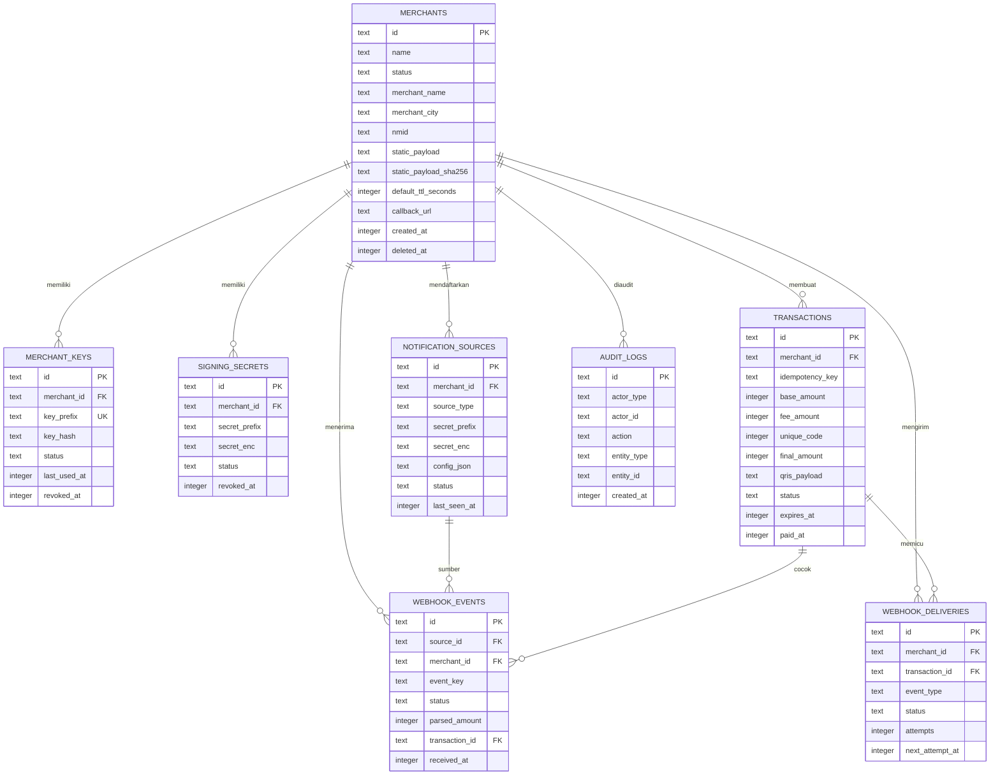
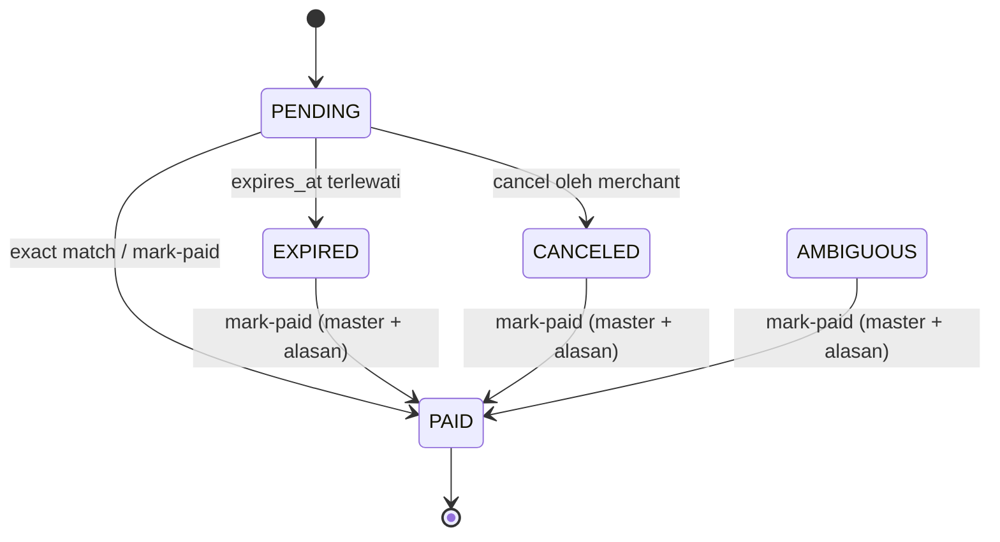
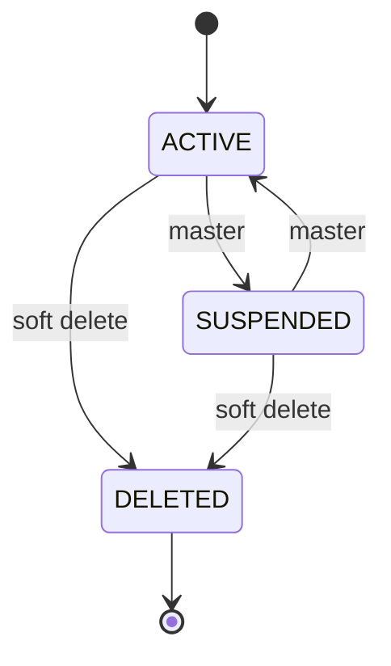
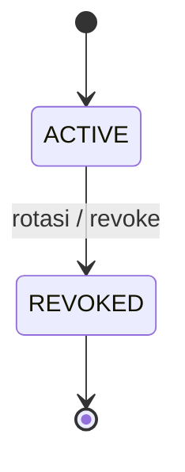
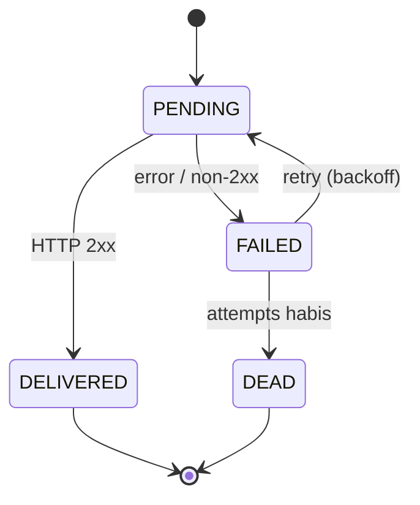

# ERP — Entity Relationship, Data & Payload Architecture — QrisStatic2Dynamic

> Versi: 1.0 · Status: Final · Tanggal: 2026-11-01
> **ERP** di dokumen ini berarti **Entity Relationship & Payload**: skema database relasional
> (ERD + DDL), state machine, model nominal, dan kontrak data JSON.
> Dokumen terkait: [PRD](./PRD.md) · [RULES](./RULES.md) · [README](./README.md) · [AGENTS](./AGENTS.md)

---

## 1. Prinsip Data

1. **Uang = integer rupiah (`INTEGER`/`i64`).** Tidak ada `REAL`, `f64`, atau desimal.
2. **Waktu di database = epoch milliseconds UTC (`INTEGER`).** API mengembalikan RFC3339 UTC.
3. **ID = prefix + ULID** (sortable, 26 karakter). Contoh: `mch_01J...`, `txn_01J...`.
4. **Soft delete** untuk merchant; transaksi dan audit tidak pernah dihapus.
5. **Secret tidak pernah plaintext**: API key = SHA-256; signing/source secret = AES-256-GCM.
6. **Semua query parameterized**; tidak ada string SQL yang dirakit dari input.
7. **SQLite WAL + foreign keys**; transaksi singkat; alokasi kode unik memakai `BEGIN IMMEDIATE`.
8. **Payload QRIS adalah data bisnis sensitif**: tidak dicatat di log, hanya disimpan
   pada profil merchant dan transaksi yang memang membutuhkannya.

---

## 2. ERD



---

## 3. DDL SQLite

Semua migrasi berada di `migrations/` dan dijalankan dengan `sqlx::migrate!` saat startup
(atau `qris-cli migrate`). Urutan pembuatan tabel mengikuti foreign key.

### 3.1 Pragmas Wajib

```sql
PRAGMA journal_mode = WAL;
PRAGMA foreign_keys = ON;
PRAGMA busy_timeout = 5000;
PRAGMA synchronous = NORMAL;
PRAGMA temp_store = MEMORY;
```

### 3.2 `merchants`

```sql
CREATE TABLE merchants (
    id                          TEXT PRIMARY KEY,
    name                        TEXT NOT NULL,
    status                      TEXT NOT NULL DEFAULT 'ACTIVE'
                                CHECK (status IN ('ACTIVE','SUSPENDED','DELETED')),
    merchant_name               TEXT NOT NULL,
    merchant_city               TEXT NOT NULL,
    country_code                TEXT NOT NULL DEFAULT 'ID' CHECK (country_code = 'ID'),
    postal_code                 TEXT,
    mcc                         TEXT,
    nmid                        TEXT,
    acquirer_guid               TEXT,
    merchant_criteria           TEXT,
    static_payload              TEXT NOT NULL,
    static_payload_sha256       TEXT NOT NULL,
    default_fee_mode            TEXT NOT NULL DEFAULT 'NONE'
                                CHECK (default_fee_mode IN ('NONE','FIXED','PERCENT')),
    default_fee_fixed           INTEGER NOT NULL DEFAULT 0 CHECK (default_fee_fixed >= 0),
    default_fee_percent_bps     INTEGER NOT NULL DEFAULT 0
                                CHECK (default_fee_percent_bps BETWEEN 0 AND 10000),
    default_unique_code_enabled INTEGER NOT NULL DEFAULT 1
                                CHECK (default_unique_code_enabled IN (0,1)),
    default_ttl_seconds         INTEGER NOT NULL DEFAULT 900
                                CHECK (default_ttl_seconds BETWEEN 60 AND 86400),
    callback_url                TEXT,
    metadata_json               TEXT NOT NULL DEFAULT '{}' CHECK (json_valid(metadata_json)),
    created_at                  INTEGER NOT NULL,
    updated_at                  INTEGER NOT NULL,
    deleted_at                  INTEGER
);

CREATE UNIQUE INDEX ux_merchants_nmid
    ON merchants(nmid)
    WHERE nmid IS NOT NULL AND deleted_at IS NULL;

CREATE UNIQUE INDEX ux_merchants_payload
    ON merchants(static_payload_sha256)
    WHERE deleted_at IS NULL;

CREATE INDEX ix_merchants_status
    ON merchants(status, deleted_at);
```

Catatan:
- `name` adalah label internal; `merchant_name`/`merchant_city` diekstrak dari tag `59`/`60`.
- `nmid` diekstrak dari sub-tag `02` pada tag `26–51` (lihat §7.5). Boleh `NULL`.
- Merchant yang dihapus tetap menyimpan payload dan transaksi untuk audit.

### 3.3 `merchant_keys`

```sql
CREATE TABLE merchant_keys (
    id            TEXT PRIMARY KEY,
    merchant_id   TEXT NOT NULL REFERENCES merchants(id) ON DELETE CASCADE,
    key_prefix    TEXT NOT NULL UNIQUE,
    key_hash      TEXT NOT NULL CHECK (length(key_hash) = 64),
    label         TEXT,
    status        TEXT NOT NULL DEFAULT 'ACTIVE'
                  CHECK (status IN ('ACTIVE','REVOKED')),
    created_at    INTEGER NOT NULL,
    last_used_at  INTEGER,
    revoked_at    INTEGER,
    expires_at    INTEGER
);

CREATE INDEX ix_merchant_keys_merchant
    ON merchant_keys(merchant_id, status);
```

- `key_prefix` = 16 karakter pertama dari key (`qsk_live_` + 10 karakter acak).
- `key_hash` = SHA-256 hex lowercase dari key penuh. Key hanya ditampilkan sekali.
- `last_used_at` diperbarui maksimal sekali per menit per key untuk menghindari write amplification.

### 3.4 `signing_secrets`

```sql
CREATE TABLE signing_secrets (
    id            TEXT PRIMARY KEY,
    merchant_id   TEXT NOT NULL REFERENCES merchants(id) ON DELETE CASCADE,
    secret_prefix TEXT NOT NULL,
    secret_enc    TEXT NOT NULL,
    status        TEXT NOT NULL DEFAULT 'ACTIVE'
                  CHECK (status IN ('ACTIVE','REVOKED')),
    created_at    INTEGER NOT NULL,
    revoked_at    INTEGER
);

CREATE UNIQUE INDEX ux_signing_secret_active
    ON signing_secrets(merchant_id)
    WHERE status = 'ACTIVE';

CREATE INDEX ix_signing_secrets_merchant
    ON signing_secrets(merchant_id, status);
```

- Satu merchant hanya punya **satu** signing secret aktif.
- `secret_enc` = base64(`nonce(12) || ciphertext || tag(16)`) AES-256-GCM.
- AAD = `signing_secrets:{id}:{merchant_id}`.
- Signing secret harus bisa dibaca server untuk verifikasi HMAC, sehingga **dienkripsi**,
  bukan di-hash.

### 3.5 `notification_sources`

```sql
CREATE TABLE notification_sources (
    id            TEXT PRIMARY KEY,
    merchant_id   TEXT NOT NULL REFERENCES merchants(id) ON DELETE CASCADE,
    source_type   TEXT NOT NULL
                  CHECK (source_type IN ('ANDROID','EMAIL','AGGREGATOR','CUSTOM')),
    name          TEXT NOT NULL,
    secret_prefix TEXT NOT NULL,
    secret_enc    TEXT NOT NULL,
    config_json   TEXT NOT NULL DEFAULT '{}' CHECK (json_valid(config_json)),
    status        TEXT NOT NULL DEFAULT 'ACTIVE'
                  CHECK (status IN ('ACTIVE','REVOKED')),
    last_seen_at  INTEGER,
    created_at    INTEGER NOT NULL,
    revoked_at    INTEGER
);

CREATE INDEX ix_sources_merchant
    ON notification_sources(merchant_id, source_type, status);
```

Contoh `config_json`:

```json
{
  "allowed_packages": ["com.gojek.merchant", "id.dana.merchant", "com.bca"],
  "allowed_senders": ["notifikasi@bca.co.id", "no-reply@bankmandiri.co.id"],
  "allowed_ips": ["103.10.10.10"]
}
```

- Untuk `ANDROID`, `allowed_packages` wajib diisi minimal satu.
- Untuk `EMAIL`, `allowed_senders` wajib diisi minimal satu domain/alamat.
- Untuk `AGGREGATOR`, `allowed_ips` opsional tetapi disarankan.
- `CUSTOM` tidak memakai allowlist.

### 3.6 `transactions`

```sql
CREATE TABLE transactions (
    id                         TEXT PRIMARY KEY,
    merchant_id                TEXT NOT NULL REFERENCES merchants(id) ON DELETE RESTRICT,
    merchant_ref               TEXT,
    idempotency_key            TEXT,
    idempotency_request_sha256 TEXT,
    base_amount                INTEGER NOT NULL CHECK (base_amount > 0),
    fee_mode                   TEXT NOT NULL DEFAULT 'NONE'
                               CHECK (fee_mode IN ('NONE','FIXED','PERCENT')),
    fee_fixed                  INTEGER NOT NULL DEFAULT 0 CHECK (fee_fixed >= 0),
    fee_percent_bps            INTEGER NOT NULL DEFAULT 0
                               CHECK (fee_percent_bps BETWEEN 0 AND 10000),
    fee_amount                 INTEGER NOT NULL DEFAULT 0 CHECK (fee_amount >= 0),
    unique_code                INTEGER NOT NULL DEFAULT 0
                               CHECK (unique_code BETWEEN 0 AND 999),
    final_amount               INTEGER NOT NULL
                               CHECK (final_amount = base_amount + fee_amount + unique_code)
                               CHECK (final_amount > 0)
                               CHECK (final_amount <= 9999999999999),
    currency                   TEXT NOT NULL DEFAULT 'IDR' CHECK (currency = 'IDR'),
    reference_label            TEXT,
    point_of_initiation        TEXT NOT NULL DEFAULT '12'
                               CHECK (point_of_initiation IN ('11','12')),
    qris_payload               TEXT NOT NULL,
    qris_payload_sha256        TEXT NOT NULL,
    status                     TEXT NOT NULL DEFAULT 'PENDING'
                               CHECK (status IN ('PENDING','PAID','EXPIRED','CANCELED','AMBIGUOUS')),
    expires_at                 INTEGER NOT NULL,
    created_at                 INTEGER NOT NULL,
    updated_at                 INTEGER NOT NULL,
    paid_at                    INTEGER,
    canceled_at                INTEGER,
    payment_source             TEXT,
    paid_event_id              TEXT,
    created_ip                 TEXT,
    request_id                 TEXT
);

CREATE UNIQUE INDEX ux_txn_idempotency
    ON transactions(merchant_id, idempotency_key)
    WHERE idempotency_key IS NOT NULL;

CREATE UNIQUE INDEX ux_txn_active_amount
    ON transactions(merchant_id, final_amount)
    WHERE status = 'PENDING';

CREATE UNIQUE INDEX ux_txn_active_code
    ON transactions(merchant_id, unique_code)
    WHERE status = 'PENDING' AND unique_code > 0;

CREATE INDEX ix_txn_merchant_created
    ON transactions(merchant_id, created_at DESC);

CREATE INDEX ix_txn_status_expires
    ON transactions(status, expires_at);
```

Catatan:
- `paid_event_id` sengaja **tanpa FK** untuk menghindari siklus
  `transactions → webhook_events → transactions`.
- `final_amount` dijaga oleh CHECK aritmetika, sehingga bug kalkulasi tidak bisa masuk.
- Partial unique index `ux_txn_active_amount` adalah **pertahanan terakhir** kecocokan ganda;
  jika `unique_code` nonaktif dan `final_amount` sudah dipakai transaksi `PENDING` lain →
  `409 TXN_AMOUNT_COLLISION` (client harus mengaktifkan kode unik atau menunggu transaksi selesai).
- `reference_label` hanya disimpan untuk kebutuhan bisnis; **tidak pernah** disuntikkan ke tag `62`.

### 3.7 `webhook_events`

```sql
CREATE TABLE webhook_events (
    id              TEXT PRIMARY KEY,
    source_id       TEXT NOT NULL REFERENCES notification_sources(id) ON DELETE RESTRICT,
    merchant_id     TEXT NOT NULL REFERENCES merchants(id) ON DELETE RESTRICT,
    event_key       TEXT NOT NULL,
    source_type     TEXT NOT NULL
                    CHECK (source_type IN ('ANDROID','EMAIL','AGGREGATOR','CUSTOM')),
    direction       TEXT NOT NULL DEFAULT 'UNKNOWN'
                    CHECK (direction IN ('CR','DR','UNKNOWN')),
    parsed_amount   INTEGER CHECK (parsed_amount IS NULL OR parsed_amount > 0),
    raw_text_masked TEXT NOT NULL,
    payload_sha256  TEXT NOT NULL,
    status          TEXT NOT NULL
                    CHECK (status IN ('RECEIVED','MATCHED','UNMATCHED','DUPLICATE','IGNORED','ERROR')),
    transaction_id  TEXT REFERENCES transactions(id) ON DELETE SET NULL,
    match_reason    TEXT,
    error_code      TEXT,
    received_at     INTEGER NOT NULL,
    processed_at    INTEGER
);

CREATE UNIQUE INDEX ux_webhook_event_key
    ON webhook_events(source_id, event_key);

CREATE INDEX ix_webhook_events_status
    ON webhook_events(merchant_id, status, received_at DESC);

CREATE INDEX ix_webhook_events_txn
    ON webhook_events(transaction_id);
```

- `event_key` berasal dari header `X-Qris-Event-Id` (wajib).
- `raw_text_masked` menyimpan teks notifikasi yang sudah dimasking (lihat §10).
- Event `UNMATCHED` tidak pernah dibuang; ini antrean rekonsiliasi.

### 3.8 `webhook_deliveries`

```sql
CREATE TABLE webhook_deliveries (
    id               TEXT PRIMARY KEY,
    merchant_id      TEXT NOT NULL REFERENCES merchants(id) ON DELETE RESTRICT,
    transaction_id   TEXT REFERENCES transactions(id) ON DELETE SET NULL,
    event_type       TEXT NOT NULL
                     CHECK (event_type IN ('transaction.paid','transaction.expired','transaction.canceled','merchant.test')),
    url              TEXT NOT NULL,
    payload_json     TEXT NOT NULL CHECK (json_valid(payload_json)),
    status           TEXT NOT NULL DEFAULT 'PENDING'
                     CHECK (status IN ('PENDING','DELIVERED','FAILED','DEAD')),
    attempts         INTEGER NOT NULL DEFAULT 0 CHECK (attempts >= 0),
    next_attempt_at  INTEGER NOT NULL,
    last_status_code INTEGER,
    last_error       TEXT,
    created_at       INTEGER NOT NULL,
    delivered_at     INTEGER
);

CREATE UNIQUE INDEX ux_delivery_event
    ON webhook_deliveries(transaction_id, event_type)
    WHERE transaction_id IS NOT NULL AND event_type <> 'merchant.test';

CREATE INDEX ix_delivery_due
    ON webhook_deliveries(status, next_attempt_at);
```

- Tabel ini berfungsi sebagai **outbox**; worker mengirim ulang sampai sukses/DEAD.
- `merchant.test` tidak di-dedup karena boleh dipanggil berulang.

### 3.9 `audit_logs`

```sql
CREATE TABLE audit_logs (
    id            TEXT PRIMARY KEY,
    actor_type    TEXT NOT NULL CHECK (actor_type IN ('MASTER','MERCHANT','SYSTEM')),
    actor_id      TEXT,
    action        TEXT NOT NULL,
    entity_type   TEXT NOT NULL,
    entity_id     TEXT,
    request_id    TEXT,
    ip            TEXT,
    user_agent    TEXT,
    metadata_json TEXT NOT NULL DEFAULT '{}' CHECK (json_valid(metadata_json)),
    created_at    INTEGER NOT NULL
);

CREATE INDEX ix_audit_entity
    ON audit_logs(entity_type, entity_id, created_at DESC);

CREATE INDEX ix_audit_created
    ON audit_logs(created_at);
```

Aksi yang wajib diaudit:
`merchant.create`, `merchant.update`, `merchant.suspend`, `merchant.delete`,
`merchant.key.rotate`, `merchant.key.revoke`, `merchant.source.create`,
`merchant.source.revoke`, `transaction.create`, `transaction.cancel`,
`transaction.mark_paid`, `webhook.source.reject`, `auth.master.fail`.

### 3.10 `request_nonces`

```sql
CREATE TABLE request_nonces (
    credential_id TEXT NOT NULL,
    nonce         TEXT NOT NULL,
    seen_at       INTEGER NOT NULL,
    PRIMARY KEY (credential_id, nonce)
) WITHOUT ROWID;

CREATE INDEX ix_nonces_seen ON request_nonces(seen_at);
```

- `credential_id` = `"master"` atau `key_<id>`.
- Nonce disimpan selama `2 × SIGNATURE_MAX_SKEW` (default 600 detik), lalu dibersihkan worker.
- Ini membuat replay protection tetap berlaku setelah restart dan lintas request.

### 3.11 Tabel internal SQLx

`_sqlx_migrations` dibuat otomatis oleh `sqlx::migrate!`. Jangan dimodifikasi manual.

---

## 4. Index dan Constraint — Alasan

| Index/constraint | Mencegah |
|---|---|
| `ux_merchants_nmid` | Dua merchant mendaftarkan NMID yang sama |
| `ux_merchants_payload` | Payload QRIS yang sama didaftarkan ulang |
| `ux_merchant_keys.key_prefix` | Tabrakan lookup key |
| `ux_signing_secret_active` | Dua secret aktif membingungkan verifikasi |
| `ux_txn_idempotency` | Transaksi ganda dari retry client |
| `ux_txn_active_amount` | Dua transaksi PENDING dengan nominal akhir sama → salah cocok |
| `ux_txn_active_code` | Dua transaksi PENDING memakai kode unik sama |
| `ux_webhook_event_key` | Event notifikasi yang sama diproses dua kali |
| `ux_delivery_event` | Callback `paid` ganda untuk transaksi yang sama |
| `CHECK final_amount = ...` | Bug aritmetika fee/kode unik |
| `CHECK json_valid(...)` | JSON config/metadata rusak |

---

## 5. State Machine

### 5.1 Transaksi



Aturan:
- `PAID` terminal; tidak bisa dibatalkan.
- `EXPIRED`/`CANCELED` hanya bisa menjadi `PAID` lewat `mark-paid` master (audit wajib).
- `AMBIGUOUS` adalah status defensif/penandaan manual untuk data lama; matcher normal
  **tidak** mengubah transaksi menjadi `AMBIGUOUS` dan tidak ada transisi otomatis dari
  `PENDING`. Jika matcher menemukan lebih dari satu kandidat, event dicatat `ERROR`
  (`MULTIPLE_CANDIDATES`) dan tidak ada transaksi yang diubah.
- Transisi status harus atomik: `UPDATE ... WHERE id=? AND status='PENDING'` lalu cek `rows_affected`.
- Setiap transisi mengisi `updated_at` dan, jika relevan, `paid_at`/`canceled_at`.

### 5.2 Merchant



Merchant `SUSPENDED`/`DELETED` tidak boleh membuat transaksi baru; transaksi lama tetap bisa dibaca.

### 5.3 Key / Secret / Source



Tidak ada reaktivasi. Rotasi = buat baru + revoke lama secara atomik.

### 5.4 Outbound Delivery



---

## 6. Model Nominal, Fee, dan Kode Unik

### 6.1 Tipe dan batas

| Field | Tipe | Batas |
|---|---|---|
| `base_amount` | `i64` rupiah | `1 ..= 999_999_999_999` |
| `fee_fixed` | `i64` rupiah | `0 ..= 999_999_999` |
| `fee_percent_bps` | `i32` basis point | `0 ..= 10_000` (0–100%) |
| `fee_amount` | `i64` rupiah | hasil kalkulasi |
| `unique_code` | `i32` | `0` (nonaktif) atau `1 ..= 999` |
| `final_amount` | `i64` rupiah | `≤ 9_999_999_999_999` (13 digit, batas tag `54`) |

### 6.2 Rumus

```
fee_amount =
  NONE    -> 0
  FIXED   -> fee_fixed
  PERCENT -> floor(base_amount * fee_percent_bps / 10_000)

final_amount = base_amount + fee_amount + unique_code
```

- Pembulatan persen selalu **floor** (tidak pernah membebani lebih dari yang dihitung).
- Fee **tidak** memakai tag `55/56/57`; seluruhnya digabung ke tag `54`.
- `unique_code` ditambahkan setelah fee.
- Nominal akhir tidak boleh mengandung desimal.

### 6.3 Alokasi kode unik

Hanya untuk transaksi **stateful** dengan `unique_code.enabled = true`.

```
BEGIN IMMEDIATE;

  -- 1) Jika client meminta kode tertentu
  if manual_code is Some(c):
      if EXISTS(SELECT 1 FROM transactions
                WHERE merchant_id = ? AND status = 'PENDING' AND unique_code = c):
          ROLLBACK -> 409 UNIQUE_CODE_UNAVAILABLE

  -- 2) Jika otomatis: coba maksimal 999 kandidat acak
  for _ in 0..999:
      c = OsRng.gen_range(1..=999)
      if NOT EXISTS(SELECT 1 FROM transactions
                    WHERE merchant_id = ? AND status = 'PENDING' AND unique_code = c):
          break
  else:
      ROLLBACK -> 409 UNIQUE_CODE_POOL_EXHAUSTED

  -- 3) Insert; partial unique index menjadi backstop jika balapan
  INSERT INTO transactions (..., unique_code, final_amount, status, ...)
  VALUES (..., c, base + fee + c, 'PENDING', ...);

COMMIT;
```

- Kode otomatis diacak agar tidak mudah ditebak dari urutan transaksi.
- Kode otomatis dilepas otomatis saat status tidak lagi `PENDING` (partial index).
- TTL default 900 detik; maksimum 999 transaksi aktif per merchant.
- Sweeper berjalan setiap 30 detik dan mengubah `PENDING` yang lewat `expires_at` menjadi `EXPIRED`.

### 6.4 Idempotency

- Header `Idempotency-Key` **atau** field body `idempotency_key` (maks 128 karakter).
- Disimpan bersama `idempotency_request_sha256` (SHA-256 dari body kanonik).
- Request ulang dengan key sama:
  - hash sama → `200 OK`, transaksi yang sama, header `Idempotent-Replay: true`;
  - hash beda → `409 TXN_IDEMPOTENCY_CONFLICT`.
- Key hanya unik per merchant.

---

## 7. Model Payload QRIS (EMVCo TLV)

### 7.1 Tag yang dikenal

| Tag | Nama | Wajib | Perlakuan API |
|---|---|---|---|
| `00` | Payload Format Indicator | Ya (`01`) | **Immutable** |
| `01` | Point of Initiation Method | Tidak | Boleh `11` → `12` (default) atau `preserve` |
| `02–25` | Reserved | — | Immutable, dipertahankan |
| `26–51` | Merchant Account Information | ≥ 1 | **Immutable byte-per-byte** |
| `52` | Merchant Category Code | Disarankan | Immutable |
| `53` | Transaction Currency | Ya (`360`) | Immutable; selain `360` ditolak |
| `54` | Transaction Amount | Tidak | **Dihapus lalu disisipkan ulang** |
| `55` | Tip/Convenience Indicator | Tidak | **Dilarang** di input; tidak pernah dibuat |
| `56` | Convenience Fee Fixed | Tidak | **Dilarang** di input; tidak pernah dibuat |
| `57` | Convenience Fee Percentage | Tidak | **Dilarang** di input; tidak pernah dibuat |
| `58` | Country Code | Ya (`ID`) | Immutable; selain `ID` ditolak |
| `59` | Merchant Name | Ya | Immutable |
| `60` | Merchant City | Ya | Immutable |
| `61` | Postal Code | Tidak | Immutable |
| `62` | Additional Data Field Template | Tidak | **Immutable byte-per-byte** |
| `63` | CRC | Ya | **Selalu dihitung ulang, selalu terakhir** |
| `64` | Merchant Information—Language | Tidak | Immutable |
| `65–79` | Reserved | — | Immutable |
| `80–99` | Unreserved | — | Immutable |

### 7.2 Aturan parsing

1. Payload harus ASCII, panjang `1..=4096` byte, diawali `000201`.
2. Setiap TLV: 2 digit tag, 2 digit panjang desimal (`00–99`), lalu nilai.
3. Panjang harus cocok dan tidak boleh melewati akhir string.
4. Tag duplikat ditolak.
5. Tag `63` wajib ada, berada di 4 karakter terakhir, dan merupakan hex 4 digit.
6. Tag `00` wajib `01`.
7. Tag `53` wajib `360`; tag `58` wajib `ID`.
8. Tag `59`, `60`, `63` wajib ada.
9. Template `26–51`, `62`, dan `64` harus merupakan TLV bersarang yang valid.
10. Tag `55/56/57` ditolak (`QRIS_UNSUPPORTED_FEE_TAGS`).
11. Tag yang tidak dikenal dipertahankan apa adanya.

### 7.3 Aturan transformasi

```
validate(payload)
tlv = parse(payload)

if any(tag in {55,56,57} for t in tlv): reject
if tlv[53] != "360": reject
if tlv[58] != "ID": reject

body = tlv without tag 54 and tag 63

if point_of_initiation == "dynamic" and tag 01 exists and value == "11":
    tag 01 = "12"
elif point_of_initiation == "preserve":
    biarkan tag 01 apa adanya

insert {54: digits(final_amount)} immediately after tag 53
    (fallback: before tag 58, else before tag 63)

encoded = encode_tlv(body)
without_crc = encoded + "6304"
crc = crc16_ccitt_false(without_crc)
result = without_crc + crc
assert_invariants(result)
```

`assert_invariants` wajib memeriksa:
- semua tag selain `01/54/63` identik dan urutannya sama;
- tag `62` byte-identik;
- tag `54` ada dan nilainya `final_amount`;
- tidak ada tag `55/56/57`;
- CRC valid;
- hasil dapat di-parse ulang.

### 7.4 Contoh kerja (golden vector)

Payload statis sintetis yang **struktural valid** dan meniru QRIS nyata dengan
**dua merchant account** (tag `26` milik acquirer + tag `51` milik QRIS):

```
00020101021126600014ID.EXAMPLE.WWW011893600000000000000102090000000010303UMI51440014ID.CO.QRIS.WWW0215ID10240012345670303UMI5204581253033605802ID5908KOS SAYA6007JAKARTA63044CDB
```

Hasil konversi nominal `500000`:

```
00020101021226600014ID.EXAMPLE.WWW011893600000000000000102090000000010303UMI51440014ID.CO.QRIS.WWW0215ID10240012345670303UMI52045812530336054065000005802ID5908KOS SAYA6007JAKARTA63040B8C
```

Hasil konversi nominal `500142` (base `500000` + kode unik `142`):

```
00020101021226600014ID.EXAMPLE.WWW011893600000000000000102090000000010303UMI51440014ID.CO.QRIS.WWW0215ID10240012345670303UMI52045812530336054065001425802ID5908KOS SAYA6007JAKARTA63048653
```

Perbedaan hanya pada tag `01` (`11`→`12`), tag `54` (baru), dan tag `63` (CRC).
Tag `26`, `51`, `52`, `53`, `58`, `59`, `60` identik byte-per-byte.

### 7.5 Ekstraksi identitas merchant

Pindai **semua** tag `26–51` sebagai TLV bersarang. QRIS nyata dapat memiliki lebih dari
satu akun (mis. tag `26` = akun acquirer, tag `51` = akun QRIS domestik).

| Sub-tag | Arti | Contoh |
|---|---|---|
| `00` | Globally Unique Identifier | `ID.CO.QRIS.WWW`, `ID.EXAMPLE.WWW` |
| `01` | Acquirer merchant ID | `936000000000000001` |
| `02` | Merchant ID / NMID | `ID1024001234567` (QRIS) atau `000000001` (acquirer) |
| `03` | Merchant criteria | `UMI`, `UME`, `UBE` |

Aturan pemilihan:

1. Utamakan akun dengan sub-tag `00` berisi `ID.CO.QRIS` **dan** sub-tag `02` cocok
   dengan pola NMID `^ID[0-9]{13,15}$`.
2. Fallback: akun pertama yang sub-tag `02`-nya cocok dengan pola NMID tersebut.
3. Jika tidak ada, `nmid = NULL`; jangan menebak dari angka internal acquirer.
4. `acquirer_guid` diambil dari sub-tag `00` akun terpilih.
5. `merchant_criteria` diambil dari sub-tag `03`; fallback ke sub-tag `01` hanya jika
   nilainya tepat `UMI`/`UME`/`UBE`.
6. `acquirer_merchant_id` (sub-tag `01`) hanya metadata; tidak disimpan di kolom wajib.
7. Jangan pernah menormalkan, menggabungkan, atau menulis ulang nilai sub-tag; ini hanya
   untuk metadata.

Contoh: pada QRIS dengan tag `26` (akun acquirer) dan tag `51` (akun QRIS), sub-tag `02`
akun acquirer dapat berisi ID internal 9 digit (`000000001`), sedangkan NMID sebenarnya
ada di tag `51` (`ID1024001234567`). Memilih akun pertama tanpa aturan di atas akan
menyimpan NMID yang salah.

---

## 8. Konvensi API

### 8.1 Base dan format

- Base path: `/api/v1`.
- JSON: `snake_case`, UTF-8, `Content-Type: application/json`.
- Waktu respons: RFC3339 UTC (`2026-11-01T10:15:00Z`).
- Nominal: JSON integer rupiah (bukan string, bukan desimal).
- Sukses: objek resource langsung; list: `{"items": [...], "next_cursor": "..."}`.
- Error: envelope standar (lihat §8.4).
- Setiap respons memuat header `X-Request-Id`.

### 8.2 Autentikasi

| Grup endpoint | Kredensial | Default |
|---|---|---|
| `/healthz`, `/readyz` | — | publik |
| `/qris/parse`, `/qris/dynamic` | Bearer merchant/master | wajib (kecuali `ALLOW_PUBLIC_STATELESS=true`) |
| `/merchants` (create/list), keys, sources, mark-paid, test-webhook | Bearer master | wajib |
| `/merchants/{id}` GET | Bearer master/owner | wajib |
| `/transactions/*` | Bearer merchant/master | merchant hanya untuk miliknya |
| `/webhooks/mutation/{source_id}` | HMAC source secret | wajib |

Format: `Authorization: Bearer <key>`.

- Master key: dari `MASTER_API_KEY`, minimal 32 karakter, dibandingkan constant-time.
- Merchant key: `qsk_live_` + 40 karakter base62; server hanya menyimpan SHA-256.
- Source secret: `qws_live_` + 40 karakter base62; disimpan terenkripsi.
- Signing secret: `qss_live_` + 40 karakter base62; disimpan terenkripsi.

### 8.3 Signed request (HMAC)

Aktif bila `REQUIRE_SIGNED_REQUESTS=true` (default produksi: `true`) untuk **semua
request non-GET ber-autentikasi**. Header:

```
X-Qris-Timestamp: 1767225600          # epoch detik
X-Qris-Nonce: 01J8Z...                # 16–64 karakter, unik per request
X-Qris-Signature: v1=<hex lowercase>
```

Kanonik:

```
canonical = timestamp + "\n"
          + nonce + "\n"
          + METHOD_UPPERCASE + "\n"
          + path_and_query + "\n"
          + lower_hex(sha256(raw_body))
```

- `raw_body` adalah byte body persis seperti dikirim; body kosong → SHA-256 dari string kosong.
- `path_and_query` termasuk query string apa adanya, tanpa fragment.
- Signature = `HMAC-SHA256(secret, canonical)`, hex lowercase.
- Master request memakai `MASTER_API_KEY` sebagai secret.
- Merchant request memakai signing secret aktif.
- Skew maksimal `SIGNATURE_MAX_SKEW_SECONDS` (default 300).
- Nonce disimpan di `request_nonces`; duplikat → `SIGNATURE_REPLAYED`.
- Signature dibandingkan constant-time.

### 8.4 Error envelope

```json
{
  "error": {
    "code": "QRIS_INVALID_CRC",
    "message": "Checksum QRIS tidak cocok.",
    "details": { "expected": "4CDB", "actual": "0000" },
    "request_id": "req_01J8Z..."
  }
}
```

- `message` berbahasa Indonesia dan aman ditampilkan ke pengguna.
- `details` opsional; tidak boleh memuat secret, stack trace, SQL, atau path internal.
- Daftar kode error lengkap ada di [RULES.md](./RULES.md) §14.

### 8.5 Pagination

- Query: `?limit=50&cursor=<opaque>`; `limit` 1–100, default 50.
- `cursor` adalah ID ULID terakhir (di-base64url) atau `null`.
- Response: `{"items":[...],"next_cursor":"..."}`; `next_cursor=null` jika habis.

---

## 9. Kontrak JSON

### 9.1 `POST /api/v1/qris/parse`

Request JSON:

```json
{
  "payload": "000201010211...63044CDB",
  "include_tlv": true
}
```

Atau `multipart/form-data` dengan field file `image` (PNG/JPEG/WebP) dan opsional `include_tlv`.

Response `200`:

```json
{
  "valid": true,
  "is_dynamic": false,
  "payload": "000201010211...63044CDB",
  "payload_sha256": "9f2c...",
  "crc": "4CDB",
  "currency": "IDR",
  "country": "ID",
  "amount": null,
  "point_of_initiation": "11",
  "merchant": {
    "name": "KOS SAYA",
    "city": "JAKARTA",
    "postal_code": null,
    "mcc": "5812",
    "nmid": "ID1024001234567",
    "acquirer_guid": "ID.CO.QRIS.WWW",
    "merchant_criteria": "UMI"
  },
  "tlv": [
    { "tag": "00", "length": 2, "value": "01" },
    { "tag": "01", "length": 2, "value": "11" }
  ],
  "warnings": []
}
```

- `tlv` hanya ada jika `include_tlv=true`.
- `amount` berupa integer atau `null`.
- Gambar yang berisi QR non-QRIS tetap dikembalikan sebagai payload, lalu validasi
  menghasilkan `422 QRIS_INVALID_PREFIX` (bukan error decode).

### 9.2 `POST /api/v1/qris/dynamic` (stateless)

Request JSON:

```json
{
  "payload": "000201010211...63044CDB",
  "amount": 500000,
  "fee": { "mode": "NONE" },
  "unique_code": { "enabled": false },
  "point_of_initiation": "dynamic",
  "reference_label": "INV-2026-0001",
  "output": { "png": true, "svg": false, "scale": 8, "ecc": "M" }
}
```

- `amount` = nominal dasar (integer > 0).
- `fee.mode`: `NONE` | `FIXED` | `PERCENT`.
  - `FIXED` wajib `fixed`.
  - `PERCENT` wajib `percent_bps`.
- `unique_code.enabled=false` default untuk stateless; untuk stateful mengikuti default merchant.
- `point_of_initiation`: `"dynamic"` (default) atau `"preserve"`.
- `reference_label` hanya metadata; tidak masuk payload.

Response `200` (`output.png=true`):

```json
{
  "payload": "000201010212...63040B8C",
  "crc": "0B8C",
  "payload_sha256": "1a2b...",
  "point_of_initiation": "12",
  "amount": {
    "base": 500000,
    "fee": 0,
    "unique_code": 0,
    "final": 500000,
    "currency": "IDR"
  },
  "merchant": { "name": "KOS SAYA", "city": "JAKARTA", "nmid": "ID1024001234567" },
  "qr": { "png_base64": "iVBORw0...", "svg": null },
  "warnings": []
}
```

Jika `output.png=true` dan `Accept: image/png`, respons boleh berupa biner PNG
dengan `Content-Type: image/png` dan `Content-Disposition: inline; filename="qris.png"`.
Payload dinamis tetap dapat diambil lewat mode JSON.

### 9.3 `POST /api/v1/merchants`

JSON:

```json
{
  "name": "Kos Sayu",
  "static_payload": "000201010211...63044CDB",
  "default_fee_mode": "NONE",
  "default_fee_fixed": 0,
  "default_fee_percent_bps": 0,
  "default_unique_code": true,
  "default_ttl_seconds": 900,
  "callback_url": "https://app.example.com/webhooks/qris"
}
```

Multipart:

```
name=Kos Sayu
static_qr=<file PNG/JPEG/WebP>
callback_url=https://app.example.com/webhooks/qris
```

- Wajib tepat salah satu: `static_payload` atau `static_qr`.
- `callback_url` wajib HTTPS/publik (kecuali `ALLOW_INSECURE_CALLBACKS=true` di dev).

Response `201`:

```json
{
  "merchant": {
    "id": "mch_01J8Z...",
    "name": "Kos Sayu",
    "status": "ACTIVE",
    "merchant_name": "KOS SAYA",
    "merchant_city": "JAKARTA",
    "nmid": "ID1024001234567",
    "acquirer_guid": "ID.CO.QRIS.WWW",
    "merchant_criteria": "UMI",
    "default_fee_mode": "NONE",
    "default_unique_code": true,
    "default_ttl_seconds": 900,
    "callback_url": "https://app.example.com/webhooks/qris",
    "created_at": "2026-11-01T10:00:00Z"
  },
  "credentials": {
    "api_key": "qsk_live_...",
    "key_prefix": "qsk_live_ab12cd34",
    "signing_secret": "qss_live_...",
    "secret_prefix": "qss_live_ab12cd34",
    "note": "Simpan sekarang. Key dan secret tidak akan ditampilkan lagi."
  }
}
```

### 9.4 `POST /api/v1/merchants/{id}/transactions`

Request:

```json
{
  "base_amount": 500000,
  "reference_label": "INV-2026-0001",
  "merchant_ref": "order-123",
  "idempotency_key": "order-123",
  "fee": { "mode": "FIXED", "fixed": 2500 },
  "unique_code": { "enabled": true },
  "ttl_seconds": 900,
  "output": { "png": true, "svg": false, "scale": 8, "ecc": "M" }
}
```

- `fee` dan `unique_code` opsional; jika tidak ada, pakai default merchant.
- `unique_code.value` opsional (1–999) untuk kode manual.
- `ttl_seconds` 60–86400; default merchant.
- `Idempotency-Key` header boleh menggantikan field body.
- Merchant key hanya boleh membuat transaksi untuk merchant miliknya.

Response `201`:

```json
{
  "id": "txn_01J8Z...",
  "merchant_id": "mch_01J8Z...",
  "merchant_ref": "order-123",
  "reference_label": "INV-2026-0001",
  "amount": {
    "base": 500000,
    "fee": 2500,
    "unique_code": 142,
    "final": 502642,
    "currency": "IDR"
  },
  "status": "PENDING",
  "point_of_initiation": "12",
  "qris": {
    "payload": "000201010212...6304ABCD",
    "crc": "ABCD",
    "png_base64": "iVBORw0...",
    "svg": null
  },
  "expires_at": "2026-11-01T10:15:00Z",
  "created_at": "2026-11-01T10:00:00Z",
  "paid_at": null,
  "payment_source": null
}
```

Replay idempotency: `200` + header `Idempotent-Replay: true` + objek yang sama.

### 9.5 `GET /api/v1/transactions/{id}/status`

```json
{
  "id": "txn_01J8Z...",
  "status": "PAID",
  "amount": { "base": 500000, "fee": 2500, "unique_code": 142, "final": 502642, "currency": "IDR" },
  "expires_at": "2026-11-01T10:15:00Z",
  "paid_at": "2026-11-01T10:04:31Z",
  "payment_source": "ANDROID"
}
```

Status: `PENDING` | `PAID` | `EXPIRED` | `CANCELED` | `AMBIGUOUS`.

### 9.6 `GET /api/v1/transactions/{id}/stream` (SSE)

```
event: status
id: txn_01J8Z...
data: {"id":"txn_01J8Z...","status":"PAID","paid_at":"2026-11-01T10:04:31Z","amount":{"final":502642}}
```

- Heartbeat komentar (`: ping`) setiap 15 detik.
- Stream ditutup setelah status terminal atau 5 menit; client boleh reconnect.
- `retry: 3000`.

### 9.7 `POST /api/v1/merchants/{id}/sources`

Request:

```json
{
  "type": "ANDROID",
  "name": "HP Kasir",
  "config": {
    "allowed_packages": ["com.gojek.merchant", "id.dana.merchant", "com.bca"]
  }
}
```

Response `201`:

```json
{
  "source": {
    "id": "src_01J8Z...",
    "type": "ANDROID",
    "name": "HP Kasir",
    "status": "ACTIVE",
    "endpoint": "https://qris.example.com/api/v1/webhooks/mutation/src_01J8Z..."
  },
  "source_secret": "qws_live_...",
  "note": "Simpan sekarang. Secret tidak akan ditampilkan lagi."
}
```

### 9.8 `POST /api/v1/webhooks/mutation/{source_id}`

Header wajib:

```
X-Qris-Timestamp: 1767225600
X-Qris-Event-Id: notif-12345
X-Qris-Signature: v1=<hex>
Content-Type: application/json
```

Kanonik inbound webhook:

```
canonical = timestamp + "\n" + event_id + "\n" + lower_hex(sha256(raw_body))
signature = "v1=" + lower_hex(HMAC-SHA256(source_secret, canonical))
```

Body per tipe:

**Android**

```json
{
  "package": "com.gojek.merchant",
  "app_name": "GoPay Merchant",
  "title": "Pembayaran diterima",
  "text": "Pembayaran QRIS Rp 502.642 berhasil diterima.",
  "posted_at": "2026-11-01T10:04:30Z",
  "notification_id": "0|com.gojek.merchant|12345"
}
```

**Email**

```json
{
  "from": "notifikasi@bca.co.id",
  "subject": "Mutasi Rekening",
  "text": "Dana masuk Rp502.642,00 pada 01/11/2026.",
  "received_at": "2026-11-01T10:04:30Z",
  "message_id": "<abc@bca.co.id>"
}
```

**Aggregator**

```json
{
  "provider": "moota",
  "reference": "mut_123",
  "amount": 502642,
  "direction": "CR",
  "occurred_at": "2026-11-01T10:04:30Z",
  "description": "QRIS KOS SAYA"
}
```

**Custom**

```json
{
  "amount": 502642,
  "direction": "CR",
  "occurred_at": "2026-11-01T10:04:30Z",
  "description": "Pembayaran invoice INV-2026-0001",
  "reference": "INV-2026-0001"
}
```

Response `202`:

```json
{
  "event_id": "evt_01J8Z...",
  "status": "MATCHED",
  "transaction_id": "txn_01J8Z...",
  "reason": "exact_amount_match"
}
```

Status event: `MATCHED` | `UNMATCHED` | `DUPLICATE` | `IGNORED` | `ERROR`.
Event yang tidak cocok tetap `202` dan disimpan; bukan error HTTP.

### 9.9 Outbound webhook

Header:

```
X-Qris-Event: transaction.paid
X-Qris-Event-Id: dlv_01J8Z...
X-Qris-Timestamp: 1767225600
X-Qris-Signature: v1=<hex>
Content-Type: application/json
```

Body:

```json
{
  "event": "transaction.paid",
  "event_id": "evt_01J8Z...",
  "created_at": "2026-11-01T10:04:31Z",
  "data": {
    "transaction_id": "txn_01J8Z...",
    "merchant_id": "mch_01J8Z...",
    "reference_label": "INV-2026-0001",
    "amount": { "base": 500000, "fee": 2500, "unique_code": 142, "final": 502642, "currency": "IDR" },
    "status": "PAID",
    "paid_at": "2026-11-01T10:04:31Z",
    "payment_source": "ANDROID"
  }
}
```

Signature memakai signing secret merchant:

```
canonical = timestamp + "\n" + event_id + "\n" + lower_hex(sha256(raw_body))
```

Event yang dikirim: `transaction.paid`, `transaction.expired`, `transaction.canceled`,
`merchant.test`.

---

## 10. Data Classification, Masking, dan Retensi

| Data | Klasifikasi | Penyimpanan | Retensi |
|---|---|---|---|
| API key | Secret | SHA-256 saja | Sampai revoke + 90 hari metadata |
| Signing/source secret | Secret | AES-256-GCM | Sampai revoke |
| Master key | Secret | Environment, tidak di DB | Selama deployment |
| Payload QRIS statis | Sensitif | Plaintext DB (perlu untuk transaksi) | Sampai merchant dihapus |
| Payload QRIS dinamis | Sensitif | Plaintext DB (riwayat) | 365 hari |
| Teks notifikasi | Sensitif | `raw_text_masked` | 90 hari |
| Nominal/transaksi | Bisnis | Plaintext DB | 365 hari |
| Audit log | Bisnis | Plaintext DB | 365 hari |
| Nonce | Operasional | DB | 10 menit |
| Delivery payload | Bisnis | Plaintext DB | 90 hari |

Aturan masking `raw_text_masked`:

- Nomor rekening/telepon (deret ≥ 8 digit yang bukan nominal) diganti `****`.
- Nama orang dan nomor referensi boleh dipertahankan jika tidak mengandung data pribadi.
- Nominal yang berhasil diekstrak tetap disimpan di `parsed_amount`.
- Teks mentah **tidak pernah** disimpan dan tidak pernah di-log.

Retensi dijalankan oleh worker harian; penghapusan bersifat hard delete untuk data operasional
(nonce, delivery) dan arsip untuk audit sesuai kebijakan.

---

## 11. Migrasi, Backup, dan Pemulihan

### 11.1 Migrasi

- File: `migrations/0001_init.sql`, `migrations/0002_*.sql`, dst.
- Hanya **additive**: tambah tabel/kolom/index; jangan hapus/rename kolom di produksi.
- Perubahan destruktif harus lewat ADR + backup + langkah manual.
- `sqlx::migrate!` dijalankan saat startup; jika gagal, proses berhenti (fail fast).

### 11.2 Backup

- Harian: `qris-cli backup --out /backup/qris-YYYYMMDD.db` memakai `VACUUM INTO`.
- Sebelum migrasi produksi: backup wajib + verifikasi `PRAGMA integrity_check`.
- Simpan minimal 7 backup harian + 4 mingguan di lokasi terpisah.
- Backup berisi payload merchant dan hash key; perlakukan sebagai secret.

### 11.3 Pemulihan

1. Hentikan API.
2. Ganti file database dengan backup terverifikasi.
3. Jalankan `PRAGMA integrity_check` dan `qris-cli migrate`.
4. Nyalakan API; cek `/readyz`.
5. Audit transaksi `PENDING` di sekitar waktu insiden.

---

## 12. Pemetaan Tipe Rust ↔ SQLite ↔ JSON

| Domain | Rust | SQLite | JSON |
|---|---|---|---|
| Uang | `i64` (`Amount`) | `INTEGER` | number |
| Waktu | `i64` epoch ms / `OffsetDateTime` | `INTEGER` | string RFC3339 |
| ID | `String` newtype | `TEXT` | string |
| Status | `enum` + `sqlx::Type` | `TEXT` | string |
| Boolean | `bool` | `INTEGER 0/1` | boolean |
| Config | `serde_json::Value` | `TEXT` JSON | object |
| Hash | `[u8; 32]` / hex `String` | `TEXT` 64 | string |
| Secret | `SecretString` | `TEXT` terenkripsi | **tidak pernah** |
